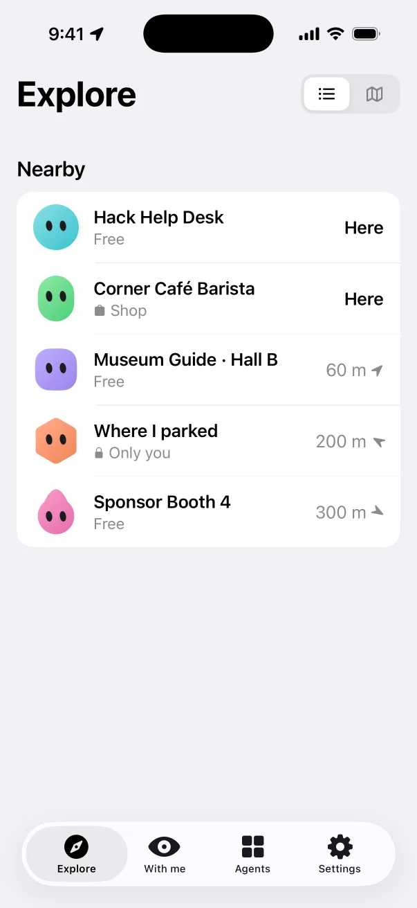
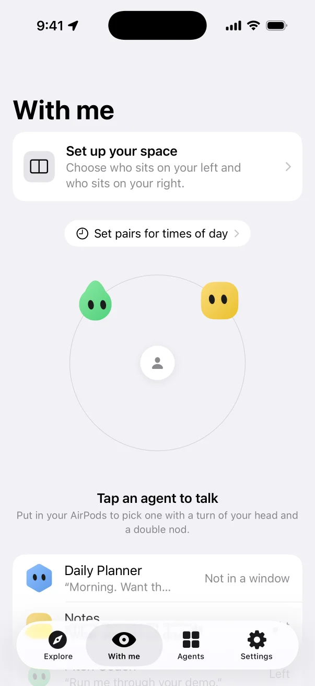
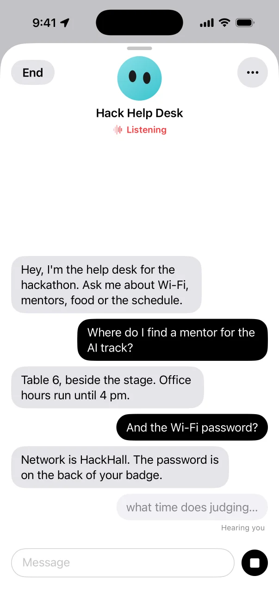
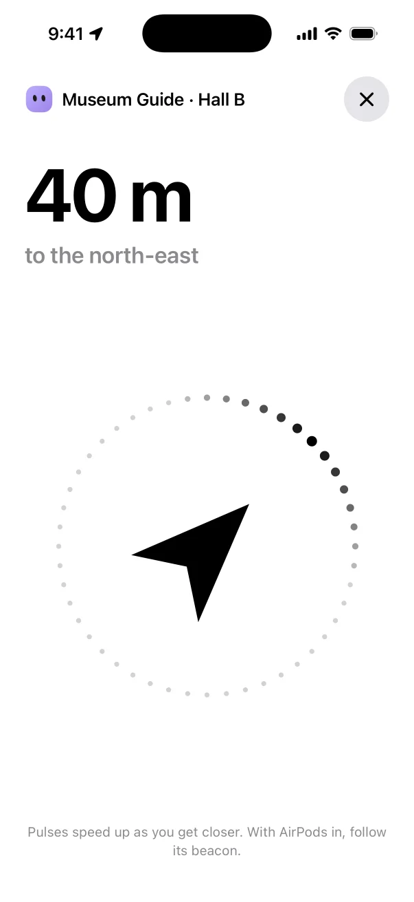
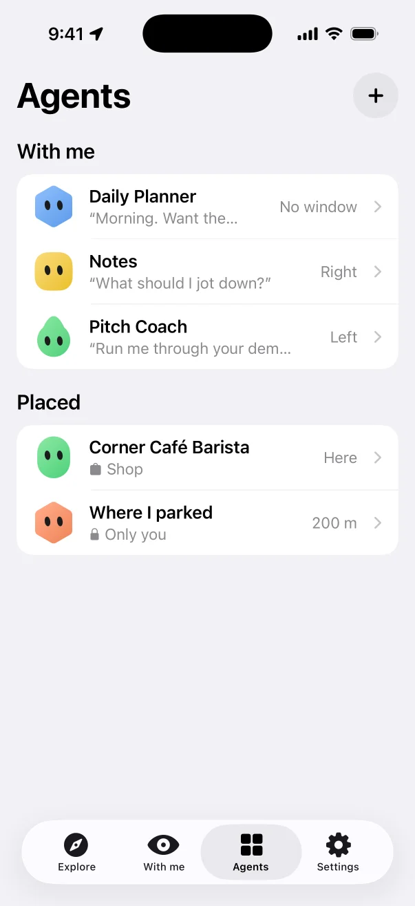
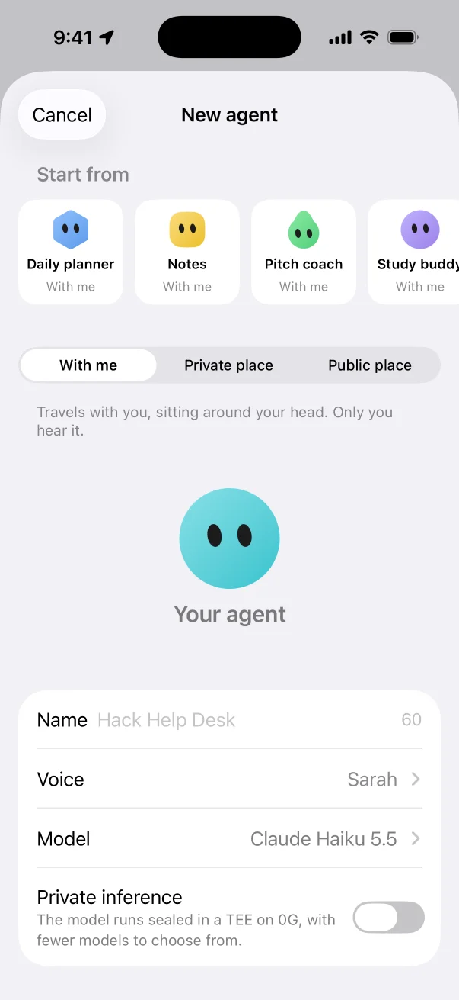
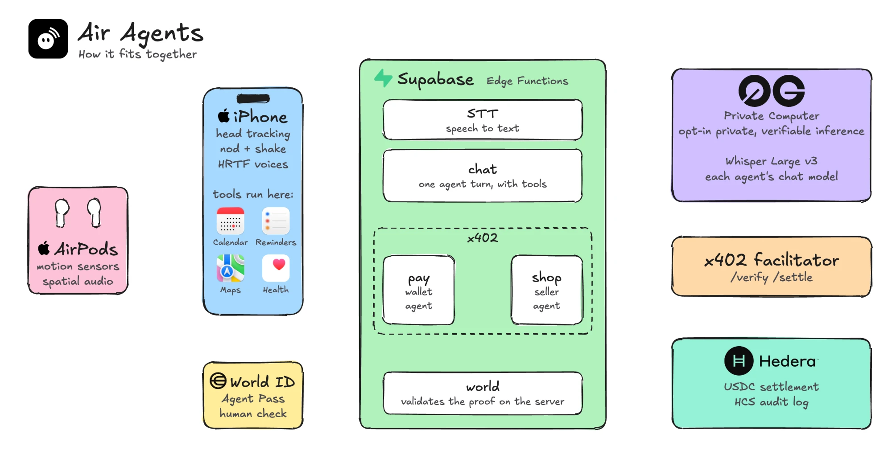

# Air Agents

Your AI agents sit in the space around you. Turn to one, double nod, and talk. It replies from where it sits.

[Website](https://air-agents.vercel.app/) · [Demo video](https://youtu.be/QWUU-ps2pFI)

## Screenshots

| Explore | With me | Conversation |
|:---:|:---:|:---:|
|  |  |  |
| **Find** | **Agents** | **Create** |
|  |  |  |

## Architecture



## Gestures

| Gesture | Meaning |
|---|---|
| Turn left or right | Pick that agent (it lights up) |
| Double nod | Wake it, or say yes |
| Double shake | End the conversation, or say no |
| Speak | Talk to the agent you've woken |

## What it does

- **With me:** personal agents travel with you, one on your left and one on your right.
- **Placed agents:** pin an agent to a place. Private ones are yours alone; anyone nearby can find public ones. Find guides you there, then you hear it in 3D audio.
- **Phone tools:** personal agents can use Calendar, Reminders, Health (read only), Maps, Weather, and alarms and timers. Tools run on the iPhone and are switched per agent.
- **Private inference:** an agent can opt in to 0G's private tier, sealed in a TEE, with a smaller set of TeeML models. If its model is unavailable, the turn fails rather than dropping to a lower tier. This covers the model and speech to text, not `tts`.
- **Shops:** a public agent can sell from a menu. Say "I'll have a cappuccino" and your wallet agent pays in USDC over x402 on Hedera. Above your limit ($5 a purchase, $20 a day by default) the purchase waits for a World ID human check. Every payment is logged to an HCS topic.

## Run it

Needs iOS 26, Xcode and AirPods with head tracking. Open `iOS/AgentsphereMobile.xcodeproj` and run the **Agentsphere** scheme on a device. `iOS/project.yml` is the XcodeGen source.

Test the model routing:

```bash
deno test supabase/functions/chat/routing_test.ts
```

## Backend

Supabase Edge Functions in `supabase/functions`:

| Function | What it does |
|---|---|
| `stt` | Speech to text with Whisper Large v3 on 0G |
| `chat` | One agent turn through the 0G Compute Router |
| `tts` | Agent voices with ElevenLabs |
| `pay` | The visitor's wallet agent: pays within limits, otherwise asks for a World ID check |
| `shop` | The x402 seller: answers `402`, then verifies and settles through the facilitator and logs to HCS |
| `merchant` | Saves the menu and creates the shop's wallet |
| `world` | Validates the World ID proof on the server |

## Proof on Hedera testnet

- Settled payment, 0.50 USDC, buyer `0.0.11339254` → shop `0.0.11339213`:
  `0.0.9185802@1793968211.903481982` ([HashScan](https://hashscan.io/testnet/transaction/0.0.9185802-1793968211-903481982))
- Ordered by voice through chat: `0.0.9185802@1793968264.064547811` ([HashScan](https://hashscan.io/testnet/transaction/0.0.9185802-1793968264-064547811))
- Spending audit log: HCS topic [`0.0.11339212`](https://hashscan.io/testnet/topic/0.0.11339212)
- An $8 order over the $5 limit came back as `checkpoint` and nothing was paid; retrying with the
  unapproved approval was refused ("wasn't approved (pending). Nothing was paid.").

## Set up your own shop backend

1. A Hedera testnet ECDSA account from [portal.hedera.com](https://portal.hedera.com).
2. `npx supabase secrets set HEDERA_OPERATOR_ID=0.0.x HEDERA_OPERATOR_KEY=0x… WALLET_ENC_KEY=$(openssl rand -base64 32)`
   (optional: `X402_FACILITATOR`; World ID: `WORLD_ISSUER`, `WORLD_CLIENT_ID`, `WORLD_CLIENT_SECRET`).
3. `npx supabase db push --remote` and deploy the functions (`shop`, `pay`, `merchant`, `world`, `chat`).
4. Call `POST /functions/v1/merchant/setup` once (signed in): associates the operator with USDC and creates the audit topic.
5. Send test USDC to the operator from [faucet.circle.com](https://faucet.circle.com) (Hedera Testnet). New buyer wallets start with 10 USDC from it.

## AI tools

Built with Claude Code.

## License

MIT. The AirPods frames in `web/public/airpods/` are derived from an Apple Inc. model and aren't covered by this license.
